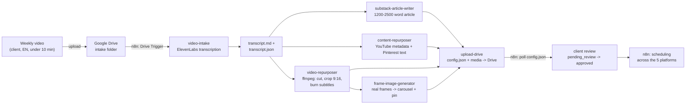

# Video-to-Social Pipeline for Digital Creators

A local pipeline, orchestrated with [Claude Code](https://claude.com/claude-code), that turns **one weekly video** from a content creator into everything needed for 5 platforms: **Substack, YouTube (long-form + Shorts), Instagram (carousel + reel), TikTok, and Pinterest** — plus automated intake/scheduling through **n8n** and **Google Drive**, following each platform's latest 2026 optimization/SEO guidelines.

Originally built for a real client (a makeup artist, EN audience 40+), then genericized for a portfolio — see [How to customize for a new client](#how-to-customize-for-a-new-client).

> This isn't a multi-tenant SaaS product with auth and hosting. It's a real production pipeline, run locally, designed to be easy to re-point at a new client through config files, not code rewrites.

## Why it exists

A content creator films a single video every week. From it, they need: a Substack article, YouTube metadata (title/description/chapters/tags), 5 short clips (Reels/TikTok/Shorts) cut from the real footage, an Instagram carousel, and a Pinterest pin — both using real frames extracted from the video, not AI-generated images. Done by hand, that's hours of video editing and writing, every single week. The pipeline automates the whole chain, while keeping a human approval step before anything gets published.

## Architecture



Every arrow leading out of `transcript.md` reads **the same single transcript** — nothing gets re-transcribed, no synthetic video is generated, all footage is real.

## The 5 platforms

| Platform | What gets generated | How |
|---|---|---|
| Substack | Full article (1200-2500 words, EN) | written from the transcript, with a persistent style guide |
| YouTube long-form | Title, description, chapters, tags, thumbnail | metadata from the transcript + timestamps |
| YouTube Shorts | Up to 5 vertical clips, subtitled | cut from the long-form footage, locally, with ffmpeg |
| Instagram | Reel (same as Shorts) + carousel (real frames + text) | ffmpeg + anchor quotes from the transcript |
| TikTok | Reel (same as Shorts) | ffmpeg |
| Pinterest | Static pin (real frame + text overlay) | ffmpeg |

Full spec per format (dimensions, SEO, content rules): [`strategy/repurposing-matrix.md`](./strategy/repurposing-matrix.md).

## Folder structure

```
video-sursa/{slug}/         video.mp4, transcript.md, transcript.json   (private, gitignored)
postari/{slug}/              generated output per platform               (private, gitignored)
├── 01-substack/
├── 02-youtube/               long-form + shorts subtype
├── 03-instagram/             carousel + reel
├── 04-tiktok/
└── 05-pinterest/
tone/                         the client's written voice (see below)
strategy/                     hashtags, repurposing matrix, config
.claude/skills/                7 Claude Code skills, one per pipeline stage
```

## Skills (Claude Code)

1. `video-intake` — picks up the oldest unprocessed video, transcribes it with ElevenLabs Speech-to-Text
2. `substack-article-writer` — writes the article from the transcript, in the client's voice
3. `content-repurposer` — YouTube long-form metadata + Pinterest pin text
4. `video-repurposer` — cuts/crops/subtitles short clips, locally, with ffmpeg
5. `frame-image-generator` — extracts real frames from the video for the carousel + pin (zero AI generation)
6. `writing-style-client` — extracts a short writing-style guide from a client writing sample (run once per client)
7. `upload-drive` — uploads everything that's ready to Google Drive, with an approval status

## Automation (n8n)

Two n8n workflows close the loop, so the pipeline doesn't depend on constant manual runs:

- **Intake:** a Google Drive Trigger watches the intake folder → downloads the new video locally → sends an email that it's ready to process.
- **Output:** on a fixed interval, looks for posts marked `pending` whose `scheduled_time` has passed → routes them by platform → notifies for publishing (the real API connections to Instagram/TikTok/YouTube/Pinterest are intentionally left **unconnected** — every branch of the workflow is ready to be wired up with that platform's business credentials, once they exist).

Both workflows are exported as reference (no real credentials) under [`n8n-workflows/`](./n8n-workflows/) — importable directly with `n8n import:workflow --input=...`.

## How to customize for a new client

1. **Written voice:** copy `tone/stil-scris-EXAMPLE.md` → `tone/stil-scris-<client>.md`, fill it in with the client's real writing/speech patterns (you can run `writing-style-client` as a starting point). Update the path in `.claude/skills/substack-article-writer`.
2. **Hashtags:** copy `strategy/hashtags/EXAMPLE-*.json` → `instagram.json`, `tiktok-reels.json`, `youtube-shorts.json`, `youtube.json`, with the client's real tags (schema: `{"general": [...], "niche": [...]}`).
3. **Environment variables:** see `.env` (excluded from git) — `ELEVENLABS_API_KEY`, `GOOGLE_DRIVE_FOLDER_ID`, `TIMEZONE`.
4. **n8n:** reconnect the Google Drive/Gmail credentials in the included workflows (exported as reference, no real data) to the new client's account.
5. The real voice/hashtag files stay **local**, excluded via `.gitignore` — the public repo only ships the `EXAMPLE` variants.

## Lessons from real use

The pipeline was tested on a real client's weekly footage, and one finding changed how the video is shot: **film from a script, with 2-3 second pauses** in which the client looks at the camera and presents the product.

Why it matters:

- A client who talks continuously is caught mid-word in most frames, so the stills for the Instagram carousel and the Pinterest pin look unpolished. A held pause gives the pipeline a clean, usable frame at every step.
- A scripted structure (a hook, then numbered steps) lets the video be cut into short clips at natural boundaries instead of at guessed timestamps.

The lesson is about process, not code: the quality of the output was limited by how the source video was filmed, so the fix was a filming guideline for the client, not a change to the pipeline.

## Troubleshooting — real issues hit along the way

### n8n: "connection cannot be established" on every Google Drive poll

**Symptom:** the Google Drive Trigger node fails constantly, for hours/days on end, with the generic error *"The connection cannot be established, this usually occurs due to an incorrect host (domain) value"*, even though the internet works fine for everything else.

**Root cause:** DNS returns the **IPv6** addresses for `googleapis.com` ahead of the IPv4 ones. The local network doesn't route IPv6 to Google correctly, and Node.js (the engine n8n runs on) tries IPv6 first and hangs there instead of quickly falling back to IPv4.

**Fix:** start n8n with the `NODE_OPTIONS=--dns-result-order=ipv4first` environment variable, which forces Node to try IPv4 before IPv6:

```bash
# permanent, Windows (PowerShell)
setx NODE_OPTIONS "--dns-result-order=ipv4first"
```

Quickly confirm it's a local network issue before suspecting credentials or workflow config — test raw connectivity directly:

```bash
curl -6 -m 6 https://www.googleapis.com   # times out => IPv6 routing is the problem
curl -4 https://www.googleapis.com        # works => the fix above solves it
```

## What the pipeline intentionally does NOT do

- No synthetic video (no AI avatar, no cinematic AI generation) — all footage is real
- Doesn't start from a written brief — the brief IS the weekly video
- No paid external service for video cutting — everything runs locally, with ffmpeg
- No auto-posting without approval — every post goes through `pending_review` → `approved`

## Dependencies

- [Claude Code](https://claude.com/claude-code) — orchestrates the skills
- Python 3 + `google-auth`, `google-auth-oauthlib`, `google-api-python-client`
- `ffmpeg` (system binary, not a Python package)
- ElevenLabs account (Speech-to-Text)
- [n8n](https://n8n.io) (local or cloud) for intake and scheduling
